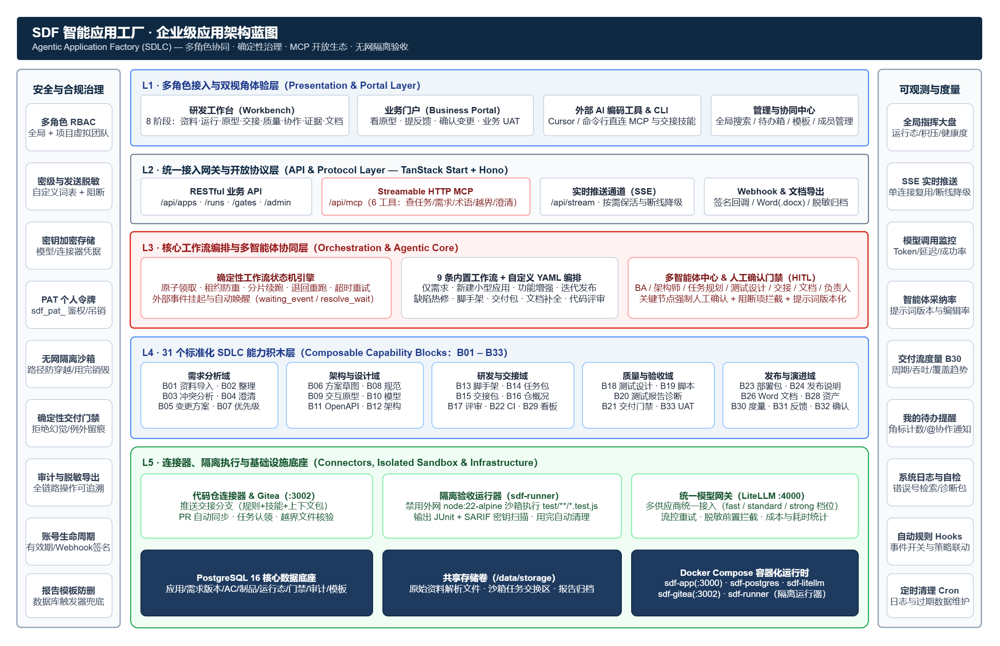
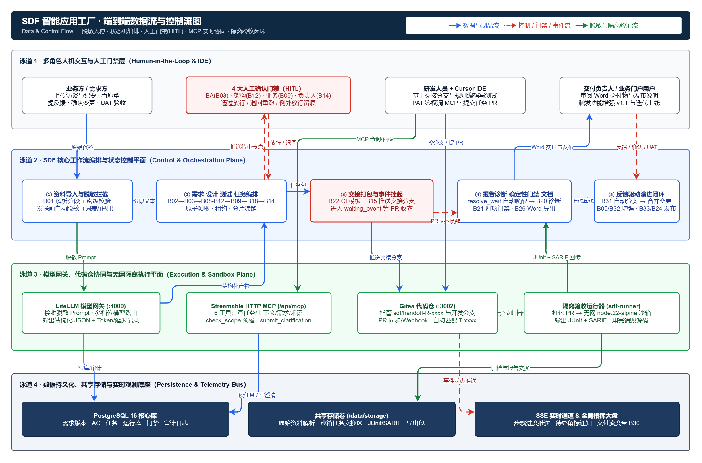

# SDF 智能应用工厂

SDF Agentic Application Factory 是面向企业软件研发与数字化交付团队的智能体驱动全生命周期平台。它把标准化流程编排、多角色 AI 智能体、关键节点人工审批、MCP 开放协同和隔离自动化验收放在同一套系统里，并能与 Jira、GitLab / Gitea 和主流 CI/CD 高效集成。

本地密钥、访问令牌和部署凭据不包含在本仓库中。请复制 `.env.example` 后自行填写。

## 应用架构

## 数据流与控制流

## 项目说明（中文）

**SDF 智能应用工厂** 是面向企业软件研发与数字化交付团队的智能体驱动全生命周期平台。传统软件交付过程中，业务调研信息分散，从需求整理、架构设计、原型制作到测试与任务拆分高度依赖人工串联，周期长且口径易漂移；同时，团队直接使用通用 AI 编程工具缺乏企业规范约束与边界管控，容易带来越界修改、数据泄露及“验收流于形式”等风险。针对这些痛点，SDF 将标准化流程编排、多角色 AI 智能体、关键节点人工审批、MCP 开放协同与隔离自动化验收融为一体，并可与企业现有研发工具链高效集成，打通从业务需求到代码交付、质量把关与持续迭代的端到端闭环。

**核心架构、流程与 AI 技术**

- **分层协同架构**：采用「研发与业务双视角门户 + 统一开放接口（API / MCP / Webhook）+ 流程与多智能体编排中枢 + 标准化交付能力组件 + 隔离验收与模型底座」的企业级分层架构，全链路内置权限管控、审计追溯与运营度量。
- **人机协同（HITL）受控流程**：通过确定性工作流引擎串联需求、设计、开发、测试与发布各阶段，在需求分析、架构方案、交互原型、任务交接等关键节点强制设置人工确认门禁，并由系统自动派发待办提醒，确保 AI 提效的同时不失控。
- **多智能体、MCP 与安全治理**：面向不同交付岗位配置专业 AI 智能体协同产出，通过统一模型网关按任务复杂度智能调度大模型并监控成本；数据送入大模型前自动进行密级校验与敏感信息脱敏；通过标准 **MCP（Model Context Protocol）** 服务实时对接主流 AI 编程工具，将最新需求、编码规范与修改边界直接注入编码环节，并在断网隔离沙箱中完成自动化测试与安全扫描。
- **企业级外部生态集成**：采用解耦的连接器、事件回调与流水线模板机制，支持与 **Jira**（需求与任务同步）、**GitLab / Gitea**（代码仓交接与合并请求联动）以及主流 **CI/CD**（GitLab CI、Jenkins、Azure Pipelines、Gitea Actions 等）高效集成，无需替换企业现有工具链即可平滑落地。

**主要场景**

- **需求到开发交接自动化**：导入原始访谈记录与会议纪要后，自动生成结构化需求、冲突分析、架构设计、可交互原型、测试用例、多平台 CI/CD 流水线模板与开发任务包，经对应角色确认后自动同步至 GitLab / Gitea 代码仓或 Jira 任务体系。
- **基于 MCP 的受控 AI 辅助研发**：开发者在日常使用的 AI 编程工具中通过 **MCP** 实时查询最新需求、验收标准、领域术语与允许修改的文件范围，提交代码前自动预检是否越界，遇到需求疑问可直接回写给业务分析师跟进。
- **隔离验收、CI/CD 联动与正式交付**：自动同步代码仓合并请求并关联对应任务，在无外网隔离环境中执行自动化测试与安全扫描，或汇入外部 CI/CD 测试与扫描报告，依据确定性规则判定交付门禁，合格后按企业统一版式一键导出 Word 规格与设计文档。
- **业务方闭环参与演进**：提供独立的业务门户，业务人员可用纯业务语言查看原型、提交反馈、确认变更方案并完成上线验收，持续驱动版本迭代。

**主要优点与可量化成果**

- **大幅提升交付效率**：需求分析、方案设计、原型与任务交接等前期准备周期由传统 **5–10 个工作日** 缩短至 **约 30 分钟**（含人工关键节点确认），相关文档与交接工时减少 **80% 以上**。
- **显著降低 AI 研发与合规风险**：通过发送前脱敏、MCP 范围预检、断网沙箱验收及确定性门禁把关，将越界改动、敏感信息泄露与模型误判等风险由 **高风险（4–5 级）优化至低风险（1–2 级）**，所有例外放行均强制人工留痕审计。
- **无缝融入企业现有生态**：不要求推倒重来，通过标准化连接器与 MCP 协议高效联动 Jira、GitLab / Gitea、CI/CD 与 AI 编程工具，降低企业推广与迁移门槛。
- **全链路清晰可追溯、跨角色高效协同**：需求、验收标准、开发任务、代码提交与测试证据自动关联，产研与业务围绕同一套事实源协作，跨部门对齐等待时间缩短 **60% 以上**。

**主要限制与下一步改进方向**

- **当前限制**：平台聚焦研发全流程编排、规范约束与自动化验收，具体业务代码仍需结合外部 AI 编程工具完成；当前隔离验收沙箱支持的技术栈相对有限，部分外部系统的深度双向同步及持续演进界面交互仍待进一步丰富。
- **下一步改进**：扩展隔离验收沙箱对企业主流后端技术栈的离线支持；深化与 Jira、GitLab 及企业级 CI/CD 平台的双向实时联动；引入企业历史架构与知识库检索，提升存量系统改造的生成准确率。

**目前进度**

- 已完成平台核心功能研发并完成端到端验证，跑通从需求资料导入、多智能体协同设计、代码仓交接与 CI/CD 模板生成、MCP 实时对接 AI 编程工具、隔离验收门禁、Word 文档导出到业务门户反馈迭代的完整闭环。

**适用人群**

- 业务分析师、系统架构师、交付/项目负责人、研发工程师、测试工程师、业务方代表及平台管理员。

## Project Description

**SDF Agentic Application Factory** is an agent-driven, end-to-end software delivery platform built for enterprise R&D and digital delivery teams. In traditional software delivery, business inputs are scattered across interviews and notes, making translation into requirements, architecture, prototypes, test plans, and development tasks slow, manual, and prone to drift. Meanwhile, adopting standalone AI coding tools without enterprise guardrails introduces out-of-scope code changes, data leakage risks, and unverified delivery quality. SDF solves these challenges by combining deterministic workflow orchestration, role-specialized AI agents, mandatory human approvals, open **MCP** collaboration, and isolated automated verification—while integrating seamlessly with existing enterprise DevOps ecosystems.

**Architecture, Workflow & AI Capabilities**

- **Layered Enterprise Architecture**: Dual-perspective portals, open gateways (API / MCP / Webhooks), workflow and multi-agent orchestration, standardized delivery modules, and isolated execution with a model gateway. Access control, audit logging, and operational metrics run across the stack.
- **Human-in-the-Loop Governance**: A deterministic workflow engine coordinates discovery through release, with mandatory human sign-off at requirements, architecture, prototype, and task handoff, plus automated cross-role notifications.
- **Multi-Agent AI, MCP & Security Guardrails**: Specialized agents work through a unified model gateway. Sensitive data is classified and redacted before it reaches a model. A standard **MCP (Model Context Protocol)** server supplies live requirements, coding standards, and file boundaries to AI coding tools, while an offline sandbox runs tests and security scans.
- **Enterprise Ecosystem Integration**: Connectors, webhooks, and pipeline templates integrate with **Jira**, **GitLab / Gitea**, and mainstream **CI/CD** systems such as GitLab CI, Jenkins, Azure Pipelines, and Gitea Actions, without replacing the existing toolchain.

**Key Scenarios**

- Turn interview notes into structured requirements, designs, prototypes, test cases, CI/CD templates, and handoff packages, then sync them to GitLab / Gitea or Jira.
- Let developers query live requirements and permitted file scope through **MCP**, check scope before submission, and send open questions back to analysts.
- Pull merge requests into an offline sandbox—or ingest external CI/CD reports—evaluate release gates, and export formatted Word specifications.
- Give business stakeholders a plain-language portal to review prototypes, submit feedback, approve changes, and complete acceptance.

**Key Benefits**

- Preparation that typically takes **5–10 business days** can be completed in **about 30 minutes**, including human reviews, reducing manual specification effort by **over 80%**.
- Pre-send redaction, MCP scope checks, offline verification, and deterministic gates lower delivery risk from **level 4–5 to level 1–2**, with an audit trail for every waiver.
- Open connectors and MCP fit Jira, GitLab / Gitea, CI/CD, and AI coding tools without a rip-and-replace rollout.
- Requirements, tasks, code changes, and test evidence stay linked, cutting cross-role alignment time by **over 60%**.

**Limitations & Next Steps**

- Source code is still written in external AI coding tools. The offline sandbox currently covers a limited set of runtimes, and deeper two-way sync with external systems is still expanding.
- Next steps are broader offline runtimes, deeper Jira / GitLab / CI/CD synchronization, and retrieval over existing enterprise architecture knowledge.

**Current Progress**

- The core platform is implemented and validated end to end: intake, multi-agent design, repository handoff, CI/CD templates, MCP integration, isolated acceptance, Word export, and the business portal feedback loop.

**Audience**

- Business analysts, architects, delivery leads, software engineers, QA engineers, business stakeholders, and platform administrators.
